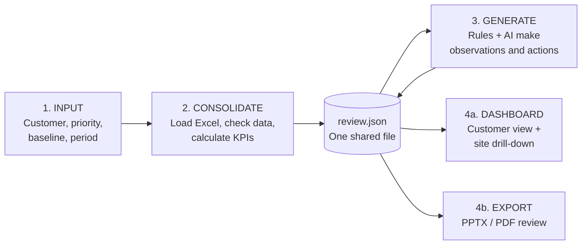

# Implementation Guide (ASD-STE100 Simplified Technical English)

> **Project:** Customer Value & Sustainability Review Generator (Lindström, Since AI 2026)
> **Source documents:** `Lindstrom_SinceAI2026/` (challenge brief, synthetic data pack, dashboard mockups)
> **Status of all data:** SYNTHETIC. Do not show any value as real Lindström data.

---

## 1. Purpose of this guide

This guide tells the team what to build. It also tells the team how to build it.
Read all of this guide before you start your work.

---

## 2. What we must deliver

The judges need all of these items. If one item is missing, we lose points.

| No. | Deliverable | Minimum requirement |
| :-- | :-- | :-- |
| D1 | Interactive dashboard | One multi-site customer (NorthStar Foods Group). Customer total and site drill-down. |
| D2 | Customer-ready review | PowerPoint (PPTX) or PDF file. The system makes the file automatically. |
| D3 | Personalization | The user selects a priority. Show a minimum of two priorities (for example, water and cost). |
| D4 | Observations | A minimum of three AI or rule observations with a recommended action. |
| D5 | Pitch and demo | A short demo of the problem, the workflow and the value. |
| D6 | Methodology note | Baselines, data sources, formulas, assumptions, uncertainty, missing data, limits. |
| D7 | Data-readiness note | A table that maps our fields to future Lindström data sources. A list of data gaps. |
| D8 | Source code | The repository `since-ai-26` with run instructions. |
| D9 | Status labels | Every value shows its status: measured, calculated, allocated, estimated or synthetic. |

---

## 3. How the judges give points

| Criterion | Weight | What this means for us |
| :-- | :-- | :-- |
| Customer and business value | 25% | Show what happened, what is important for this customer, and what to do next. |
| Feasibility and completeness | 20% | The full workflow must operate: input, dashboard, drill-down, export. |
| Sustainability credibility | 20% | Show the baseline, the boundaries, the assumptions and the confidence. |
| Data handling and calculation | 15% | Calculations must be reproducible. Show the treatment of missing or unmapped data. |
| Dynamic usability | 10% | The view must change when the user changes the priority. |
| Scalability | 10% | Show how real Lindström data can replace the synthetic data. |

> [!IMPORTANT]
> The judges do NOT give points for the largest savings. They give points for honest, clear and useful numbers.

---

## 4. The system has four parts



**The most important rule:** All parts use one shared data file, `review.json`.
The dashboard and the export read the same file. Thus, the numbers are always the same in both.

---

## 5. Part 1 — INPUT

The user gives these inputs on the first screen:

| Input | Values | Default |
| :-- | :-- | :-- |
| Customer | CUST001, CUST002, CUST003 | CUST001 (NorthStar Foods Group) |
| Reporting period | Months from 2025-01 to 2025-12 | Full year 2025 |
| Priority | Water, Emissions, Cost, Circularity, Service performance, Next-year improvement | From `Customers.priority_topics` |
| Comparison baseline | B_LOCAL, B_HOME, B_INHOUSE (sheet `Baselines`) | B_LOCAL |
| Sensitivity case | Low, Base, High | Base |
| Free-text prompt (optional) | For example: "Focus on water for the food sites." | Empty |

**Procedure:**
1. Read the customer industry from the sheet `Customers`.
2. Read the industry priorities from the sheet `Industry_Priorities`.
3. If the user gives a free-text prompt, use the AI to change the prompt into one priority value.
4. If the AI cannot find a priority, use the industry priority with rank 1.
5. Show the selected priority to the user. The user can change it.

---

## 6. Part 2 — CONSOLIDATE

### 6.1 Load the data

Load these sheets from the Excel file. Use the join keys `customer_id`, `site_id`, `laundry_id`, `product_id`, `month` and `asset_id`.

| Sheet | Level | Use |
| :-- | :-- | :-- |
| Customers, Sites, Products, Laundries | Master data | Customer hierarchy and names |
| Service_Activity | Site × product × month | Wearers, allocated pieces, scans, washes, service requests |
| Service_Cycles | Asset × cycle | Cycle hours, on-time or late |
| Repairs | Site × product × month × repair type | Repair counts, postponed replacements |
| Laundry_Resources | Laundry × month | Water, energy, emissions per kg |
| Waste_Circularity | Laundry × month | Recycling, reuse, energy recovery, incineration |
| Baselines | Baseline | Comparison factors per kg |
| Customer_Impacts | Site × product × month | Allocated footprint and savings (for check only) |
| Assumptions, Data_Quality | Registry | Show on the methodology page |

### 6.2 Check the data before you calculate

Do these checks each time that you load a file. Write the results into `review.json` under `data_quality`.

1. Find blank cells in each column.
2. Find keys that are not in the master data (unmapped records). Do not delete them. Count them and show them.
3. Make sure that each site belongs to the correct customer.
4. Make sure that the sum of customer shares for one laundry and one month is not more than 100%.

> [!WARNING]
> **Data-quality finding (check 4 fails in the pack).** Laundry L003 (Nordic Malmö WWS) washes approximately 2,500 kg each month. The customer rows for L003 show approximately 28,000 kg each month. The share sum is approximately 1,000%.
> Our solution: Calculate the customer impact with the laundry intensity (per kg) multiplied by the customer kg. This method gives the same result as the data pack. Show this finding as a data-quality flag in the dashboard and in the methodology note. This finding shows the judges that we check the data.

The pack has no blank cells and no unmapped keys. To show the treatment of missing data, make one small test file with errors. Use this test file in the demo.

### 6.3 Operational KPIs

| KPI | Formula | Sheet | Status label |
| :-- | :-- | :-- | :-- |
| Delivery sites | Count of `site_id` for the customer | Sites | Synthetic |
| Active wearers | See note A below | Service_Activity | Estimated |
| Garments allocated | Sum of `allocated_pieces` in the last month | Service_Activity | Synthetic |
| Allocation use rate | `active_assets_scanned` ÷ `allocated_pieces` | Service_Activity | Calculated |
| Idle pieces | `allocated_pieces` − `active_assets_scanned` | Service_Activity | Calculated |
| Washed kg | Sum of `customer_washed_kg` | Service_Activity | Synthetic |
| Wash frequency | `washed_pieces` ÷ `active_assets_scanned` per month | Service_Activity | Calculated |
| Service requests | Sum of `service_requests` | Service_Activity | Synthetic |
| On-time rate | Count `ON_TIME` ÷ count of all cycles | Service_Cycles | Calculated |
| Median cycle hours | Median of `cycle_hours` | Service_Cycles | Calculated |
| Repairs | Sum of `repair_count`, split by `repair_type` | Repairs | Synthetic |
| Repair rate | Repairs ÷ washed pieces × 1,000 | Repairs + Service_Activity | Calculated |

**Note A — Active wearers.** One wearer can use more than one product. Thus, the sum of all product rows counts some wearers two or more times. The data pack shows 28,367 for NorthStar in December. That value is a sum.
Do this: for each site and month, use the largest `active_wearers` value of all products. Call this value "estimated wearers (minimum)". Show the sum as "wearer-product assignments". Show both labels clearly.

**Excel dates.** The timestamps in `Service_Cycles` are Excel serial numbers. Change them to dates before you use them.

### 6.4 Footprint and handprint calculation

We tested these formulas against all 1,248 rows of `Customer_Impacts`. All rows agree.

**Customer footprint (allocated estimate):**
```
laundry_water_per_kg  = Laundry_Resources.fresh_water_l ÷ washed_kg
customer_water_l      = customer_washed_kg × laundry_water_per_kg
(Use the same method for energy, process CO2e and delivery CO2e.)
```

**Saving against the selected baseline B (handprint):**
```
water_saving_l     = customer_washed_kg × B.water_l_per_kg   − customer_water_l
energy_saving_kwh  = customer_washed_kg × B.energy_kwh_per_kg − customer_energy_kwh
co2e_saving_kg     = customer_washed_kg × (B.process_kgco2e_per_kg + B.delivery_kgco2e_per_kg)
                     − (customer_process_kgco2e + customer_delivery_kgco2e)
```
When the user changes the baseline, calculate the savings again with the new factors.

**Repair handprint (estimate, assumption A002):**
```
replacements_postponed = repair_count × repair_factor
avoided_product_co2e   = replacements_postponed × Products.synthetic_product_footprint_kgco2e
```

**Textile waste (allocated estimate, assumption A003):**
```
customer_waste_kg = customer_washed_kg × Waste_Circularity.waste_kg_per_washed_kg
Split the result by route: recycling, reuse, energy recovery, incineration.
Circular share = (recycling_kg + reuse_kg) ÷ textile_waste_total_kg
Baseline (A004): 100% of the waste goes to mixed-waste treatment.
```

**Idle stock value (illustrative only):**
```
idle_value_eur = idle_pieces × Products.synthetic_purchase_cost_eur
```
> [!CAUTION]
> The brief says that cost savings need stronger evidence. Show cost values as "illustrative". Do not show cost values as a promise of savings.

### 6.5 Low, base and high cases

Do not show one exact number for an estimate. Show a range.

| Parameter | Low | Base | High | Source |
| :-- | :-- | :-- | :-- | :-- |
| Repair factor (A002) | 0.5 | 1.0 | 1.0 | Base = data pack. Low = team assumption. |
| Baseline factors (water, energy, CO2e) | −20% | Pack value | +20% | Team assumption |

The data pack gives only one value for each factor. Thus, the low and high values are team assumptions.
Put each team assumption in the assumption registry with a new ID (T001, T002, ...).
Ask the challenge contact (Angad Roy) to confirm these values.

### 6.6 Status label for each value

Each value in `review.json` must have these fields:

```json
{
  "id": "water_saving_vs_baseline",
  "label": "Water saving vs outsourced local laundry",
  "value": { "low": 1100000, "base": 1406483, "high": 1690000 },
  "unit": "L",
  "status": "ALLOCATED_ESTIMATE",
  "formula": "customer_washed_kg × B.water_l_per_kg − customer_water_l",
  "sources": ["Service_Activity", "Laundry_Resources", "Baselines"],
  "assumptions": ["A001", "A003"],
  "confidence": "Low-Medium",
  "breakdown": { "by_site": [], "by_product": [], "by_month": [] }
}
```

Use only these status values: `MEASURED`, `CALCULATED`, `ALLOCATED_ESTIMATE`, `ESTIMATE`, `SYNTHETIC`, `PUBLIC_REFERENCE`.
The value in the example is the data pack total. Do not copy it. Calculate it.

---

## 7. Part 3 — GENERATE

### 7.1 Two steps: first rules, then AI

1. **Rules find the facts.** The rules compare sites and months. The rules find outliers. The rules give each finding a metric ID.
2. **The AI writes the text.** The AI receives only the facts from step 1. The AI writes short observations, actions and steering-committee questions.

> [!IMPORTANT]
> The AI must not calculate numbers. The AI must not make new numbers. Each sentence with a number must refer to a metric ID in `review.json`.

### 7.2 Rules to use

| Rule | Trigger | Example observation |
| :-- | :-- | :-- |
| R1 Low allocation use | Site use rate is in the lowest 20% | "Site X uses 72% of its allocated pieces. Review the allocation." |
| R2 High repair rate | Site repair rate is more than 1.5 × customer median | "Site Y has a high repair rate. Examine the work conditions." |
| R3 Late cycles | Site on-time rate is less than the customer average | "Site Z has more late cycles. Review the pickup schedule." |
| R4 Service requests | Site requests per 1,000 wearers is high | "Site W has many service requests. Find the cause." |
| R5 Water priority | Priority = Water | Show the water saving and the sites with the highest washed kg. |
| R6 Data gap | A KPI needs data that we do not have | "Service-request details are not available. Add this data source." |

Use the industry rules from `Industry_Priorities` to sort the observations. Put the most important observation for the industry first.

### 7.3 Format of an observation

```json
{
  "title": "Low allocation use at 4 Polish sites",
  "observation": "...",
  "recommended_action": "...",
  "owner": "Lindström | Customer | Both",
  "steering_question": "...",
  "metric_ids": ["allocation_use_rate"],
  "site_ids": ["S019", "S020"],
  "status": "AI_GENERATED_FROM_CALCULATED_DATA",
  "confidence": "Medium"
}
```

### 7.4 AI provider

Use the Gemini API (or a different LLM). Keep the API key in a `.env` file. Do not put the API key in Git.
Make a rules-only fallback text. If the AI is not available during the demo, the system uses the fallback text.

---

## 8. Part 4 — DASHBOARD AND EXPORT

### 8.1 Dashboard screens

Use the mockups in `Lindstrom_Managerial_dashboard_mockups_INSPIRATION.pptx` as a guide: Lindström red color, left menu, KPI cards on top.

| Screen | Content |
| :-- | :-- |
| 1. Setup | The inputs from Part 1 |
| 2. Executive overview | 4 to 6 KPI cards. Each card shows value, unit, status label and confidence. |
| 3. Priority view | The view changes with the priority. Example: water priority shows water saving and water by site. |
| 4. Site drill-down | Table and map of the 24 sites. Click a site to see its products and months. |
| 5. Baseline comparison | Lindström service against the selected baseline. Low, base and high range. |
| 6. Observations and actions | The 3 to 5 observations from Part 3 |
| 7. Methodology and data gaps | Formulas, assumptions, data-quality flags, data gaps |

**"Show the calculation" function:** When the user clicks a KPI card, show the formula, the sources, the assumptions and the status. Use the fields from section 6.6.

### 8.2 Export (PPTX or PDF)

The export uses the same `review.json`. Make these slides:

1. Title: customer, period, baseline, "SYNTHETIC DATA – PROTOTYPE" mark
2. Executive summary: key KPIs with status labels
3. Value for the selected priority
4. Baseline comparison with low, base and high range
5. Site overview: best and weakest sites
6. Observations and recommended actions
7. Questions for the steering committee
8. Methodology, assumptions and limits
9. Data gaps and next data sources

Put a footer on each slide: "Synthetic, illustrative data. Not audited. Not a Lindström claim."

---

## 9. Data gaps (show these as an output)

| Gap | Why it is important | Possible future source |
| :-- | :-- | :-- |
| Customer hierarchy is synthetic | Large customers need a correct parent and site structure | Lindström customer master data |
| Unique wearer count | The data counts wearers per product | eLindström wearer data |
| Service-request details | We cannot calculate request-free days or causes | Service-request system export |
| Cost and time evidence | Cost savings are not proven | Contract and invoice data |
| Product footprints | Values are synthetic (A005) | Approved product LCA data |
| Baseline ranges | Only one value for each factor | Approved Lindström calculator (Workwear Environmental Impact Comparison) |
| Laundry volume for L003 | Customer kg is more than laundry kg | WWS Washed Kg report |
| Industry trends and regulations | We need checked sources | Curated public references |

---

## 10. Technology

| Part | Tool |
| :-- | :-- |
| Data load and calculation | Python, pandas, openpyxl |
| API | FastAPI (sends `review.json` to the dashboard) |
| Dashboard | Next.js, Tailwind CSS, shadcn/ui, Recharts |
| AI | Gemini API |
| PPTX export | python-pptx |
| PDF export | Convert the PPTX, or use a second template |
| Tests | pytest: compare our results with `Customer_Impacts` and `Sample_Output` |

**Scalability rule:** Put the code that reads the Excel file in one module (an "adapter"). Later, a new adapter can read Tableau, Power BI or eLindström exports. The other parts do not change.

---

## 11. Do not do these things

- Do not show synthetic values as real Lindström or customer data.
- Do not use the words "audited", "verified" or "certified".
- Do not let the AI make numbers.
- Do not give legal or compliance advice. Industry rules only change the display.
- Do not show the largest possible savings as the main number. Show the base case and the range.
- Do not use public-reference values in calculations without approval.
  Note: the brief names a `Public_References` sheet. The Excel file that we received does not have this sheet. Ask the challenge contact for it.

---

## 12. Next step

1. Agree on the format of `review.json` (section 6.6). Make one sample file by hand.
2. Give each person one part (Part 1 to Part 4, plus pitch and notes).
3. Each person starts work with the sample file. Nobody waits for another person.
